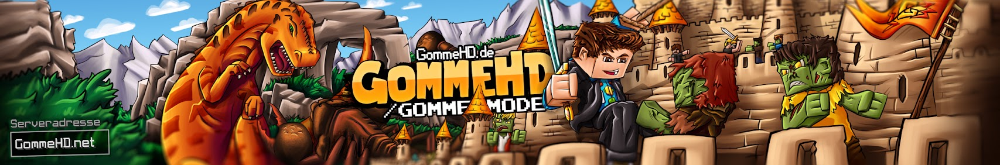

## Overview

Gommemode is a fun client-side Fabric mod for Minecraft that brings the legendary GommeHD into your world. Spawn a fully rendered GommeHD entity that keeps facing you, while the iconic [Gomme hymn](https://www.youtube.com/watch?v=2h1BJCxtNes) (produced by [Lukas, der Rapper](https://www.instagram.com/luzudemkas/)) plays in the background. Whether you're feeling nostalgic or just want some company while mining, Gommemode delivers the ultimate GommeHD experience.

## Features

- **GommeHD Entity**: Spawns a custom-rendered GommeHD entity with a unique skin texture that rotates to face you every tick
- **Gomme Hymn**: Plays the iconic Gomme hymn as positional audio when the entity spawns
- **Firework Effect**: A burst of firework particles surrounds the spawn point for a dramatic entrance
- **Toggle Keybind**: Press `G` (configurable) to toggle Gommemode on and off
- **Auto-Stop**: Gommemode turns itself off and removes the entity when the song finishes by default (it can also loop the song or keep the entity)
- **Crosshair Placement**: The entity spawns where you're looking, up to 5 blocks away by default
- **Custom Rendering**: Uses Minecraft's player model system with a custom GommeHD skin (`textures/entity/gommehd.png`)
- **Fully Configurable**: Every setting can be changed in game through ModMenu + Cloth Config, or in `config/gommemode.json`

## Planned Features

- **Multiplayer**: Let other players with the mod see the GommeHD entity and hear the hymn

## How to Use

1. **Install the mod** along with its required dependencies (see below)
2. **Launch Minecraft** with the Fabric loader
3. **Press `G`** (default keybind) to toggle Gommemode on
4. The GommeHD entity will spawn at your crosshair, up to 5 blocks away (configurable), with a firework particle effect
5. The Gomme hymn will start playing automatically
6. **Press `G` again** to deactivate and remove the entity
7. If the song ends while Gommemode is still active, it will automatically toggle off (configurable)

### Placement Mechanics

The entity spawns at the location your crosshair is pointing at, up to 5 blocks away. If nothing is in range, it spawns 5 blocks ahead of you, even in mid-air. The distance can be changed in the config, and the entity can also spawn directly at your position instead.

## Configuration

With [ModMenu](https://modrinth.com/mod/modmenu) and [Cloth Config API](https://modrinth.com/mod/cloth-config) installed, open Mods → Gommemode → Config. All options are also stored in `config/gommemode.json`.

- **General**: enable/disable the mod, toggle key, toggle cooldown, what happens when the song ends (deactivate, loop, keep entity), toggle message (off, action bar, chat)
- **Sound**: play song, volume, pitch, sound category, positional or global sound
- **Spawning**: spawn at crosshair or at the player, spawn distance, whether the crosshair stops at fluids
- **Particles**: on/off, particle type, sphere radius, particle spacing
- **Entity**: main and off hand items, main arm, arm pose, look at player (feet or eyes), scale, shadow size, name tag and its text, glowing outline and its color

## Dependencies

### Required

- [Fabric API](https://modrinth.com/mod/fabric-api) — Core Fabric hooks and utilities
- [Fabric Language Kotlin](https://modrinth.com/mod/fabric-language-kotlin) — Kotlin runtime for Fabric mods

### Optional

- [ModMenu](https://modrinth.com/mod/modmenu) — Lists Gommemode in the in-game mod menu
- [Cloth Config API](https://modrinth.com/mod/cloth-config) — Needed for Gommemode's in-game config screen (opened from ModMenu)

## FAQ

**Q: Is this mod server-side compatible?**
A: Gommemode is a client-side only mod. It does not require server installation, but you need Fabric API and Fabric Language Kotlin installed on your client.

**Q: Can I change the keybind?**
A: Yes! Open Controls in the Minecraft settings and look for "Gommemode" under the keybinding categories. You can also change it in Gommemode's config screen.

**Q: Why isn't the sound playing?**
A: Make sure the volume of the sound category set in the config (Master by default) is not muted, and that "Play Song" is enabled. By default the hymn is positional, so it gets quieter as you move away from the entity.

**Q: The entity isn't spawning!**
A: Make sure `G` isn't bound to anything else, and wait a second between presses, since the toggle has a 1-second cooldown by default. Also check that Gommemode is enabled in the config.

**Q: Can I use this on multiplayer servers?**
A: Multiplayer isn't officially supported yet, but it's planned. For now, the entity and the sound exist only on your client, so other players won't see or hear them, even if they have the mod installed.

## Links

- [GitHub Repository](https://github.com/JaroxCraft/gommemode)
- [Modrinth Page](https://modrinth.com/mod/gommemode)
- [Discord](https://discordapp.com/users/780518380733988874)
- [Original Gomme Hymn on YouTube](https://www.youtube.com/watch?v=2h1BJCxtNes)

 
